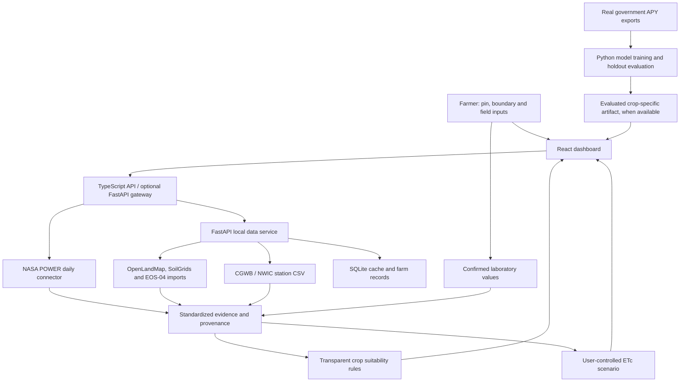

# System architecture

## Deployment split

The hosted Site runs the React application and TypeScript server routes in a Worker. It does not execute Python, Rasterio or scikit-learn. The source also contains a locally runnable Python/FastAPI service for official geospatial imports and real model training. Set the server environment variable `PYTHON_API_BASE_URL` to route dashboard API calls to that separately running service. A local loopback address is only valid when the dashboard server and Python process run on the same machine.

The local API uses SQLite with parameterized statements; farm and source data are serialized with their metadata. The PostGIS schema supplies a production database design. Implement a PostgreSQL repository adapter before migrating the service to it.

## Location and scale

Coordinates use WGS84, latitude/longitude in the UI and GeoJSON longitude/latitude for geospatial operations. Farm area (acres/hectares) is a separate farmer input from the study radius. Field polygons are validated. Radius geometries use a local azimuthal equidistant projection in metres; raster masking transforms the geometry into the raster's declared CRS.

Raster statistics use valid pixel centres within the polygon, not a single pin sample. This first implementation returns an unweighted mean, range, standard deviation and count (or categorical mode), and does not claim exact area-weighted statistics. Small fields without an intersecting valid pixel return no data. Original raster depth, scale, unit, observation date and uncertainty are retained. Soil values are selected only at the configured `AASHIRWAD_SOIL_DEPTH`, default `0-30cm`.

## API routes

| Route | Behavior |
| --- | --- |
| `POST /api/farms/analyze` | Validate inputs, gather available evidence, rank crops, return source availability |
| `GET /api/weather/historical` | NASA POWER daily data, five complete seasonal records |
| `GET /api/soil` | Python: imported soil raster queries; built-in hosted mode: explicit unavailable state |
| `GET /api/moisture` | Python: imported EOS-04 surface product |
| `GET /api/groundwater` | Python: nearby dated station observations, distances and history |
| `GET /api/crops/recommendations` | Crop profiles and method note |
| `POST /api/crops/recommendations` | Analyze a validated farm |
| `POST /api/yield/predict` | Evaluated local artifact required; otherwise 422 unavailable |
| `POST /api/irrigation/estimate` | Transparent seven-day ETc scenario |
| `POST /api/soil-tests/validate` | Python: soil-test validation and farmer-confirmation check |
| `GET /api/sources` | Publisher catalog and integration requirements |

The Site is private at first publication. Browser-local inputs persist in localStorage, and live analysis sends coordinates to the selected public climate service. The local Python service should stay on loopback for personal use; authentication is required before operating it as a shared multi-user backend. No third-party source credentials are included.
